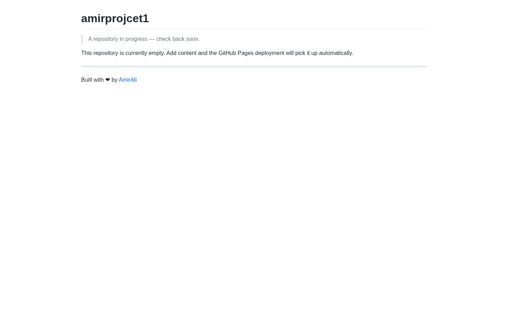

# amirprojcet1

پروژه‌ی شخصی — در حال حاضر فقط README دارد. محتوا به‌زودی اضافه می‌شود.

---

## پیش‌نمایش

## لینک‌ها

- 🌐 **سایت زنده**: https://amiralisite.github.io/amirprojcet1/
- 📦 **سورس کد**: https://github.com/amiraliSite/amirprojcet1

---

---

ساخته‌شده توسط <a href="https://github.com/amiraliSite">amiraliSite</a> · میزبانی‌شده روی GitHub Pages

